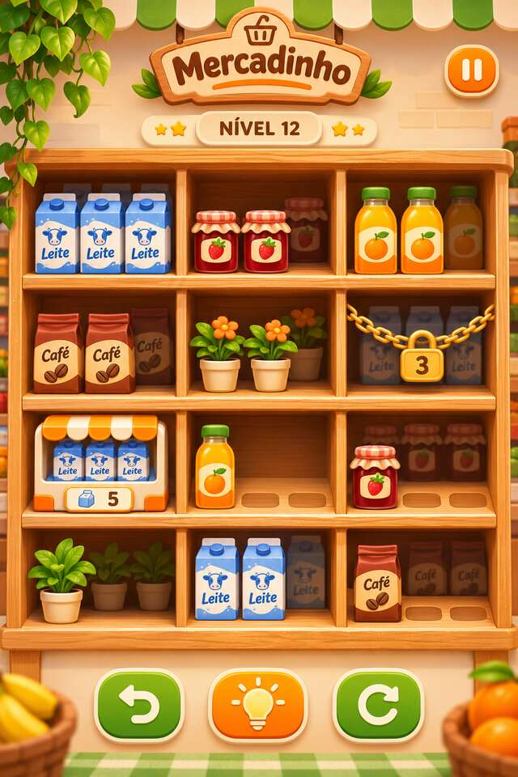

# Mercadinho

> Um jogo casual de organização de prateleiras: encontre os trios, planeje os movimentos e deixe tudo em ordem.

<p align="center">
  
</p>

**[Jogar no navegador](https://thiagodluz.github.io/Mercadinho/)** · **[Plano de desenvolvimento](PLANO-DE-DESENVOLVIMENTO.md)**

## Sobre o projeto

Mercadinho é um jogo de combinar três produtos iguais em prateleiras. A campanha está sendo desenvolvida primeiro para a web, com controles adaptados a telas de celular e computador. A versão planejada será **gratuita, sem anúncios e sem compras dentro do jogo**.

O mockup acima apresenta a direção visual inicial. As ilustrações e alguns elementos do protótipo ainda são provisórios e serão refinados durante o desenvolvimento.

## Protótipo atual

O protótipo começa com oito fases manuais. A partir da fase 9, gera fases continuamente com 6 a 14 tipos de produtos, a partir de tabuleiros com solução, com estas mecânicas:

- **Produtos:** catálogo de 20 mercadorias ilustradas provisórias.\n- **Trincas:** reúna três produtos iguais no mesmo compartimento para removê-los.
- **Prateleiras em camadas:** organize os itens da frente para revelar os que estão atrás.
- **Dispensador:** retire os produtos na ordem apresentada.
- **Correntes:** complete trios para abrir compartimentos bloqueados.
- **Dica:** procura uma sequência que conclua a fase e destaca a próxima jogada quando encontra uma solução.\n- **Controles de partida:** arraste ou selecione um produto, desfaça movimentos, pause a partida e reinicie a fase.
- **Acessibilidade:** opção para reduzir animações, além da preferência do aparelho.\n- **Progresso local:** o navegador guarda a fase mais avançada, a partida em andamento e as preferências de áudio.

O conteúdo ainda é um protótipo; número de fases, arte, áudio e regras podem mudar conforme os testes.

## Como jogar

1. Escolha um produto acessível na prateleira ou no dispensador.
2. Arraste-o até uma vaga livre ou toque no produto e depois na vaga de destino.
3. Junte três produtos iguais no mesmo compartimento.
4. Continue organizando as prateleiras até concluir a fase.

Use **Desfazer** para voltar uma jogada ou **Reiniciar** para começar a fase atual novamente. As fases são liberadas uma depois da outra. As fases geradas mantêm o mesmo tabuleiro ao reiniciar ou reabrir no mesmo navegador.

## Executar localmente

Não há dependências de instalação para o protótipo atual. Clone o repositório e abra `index.html` em um navegador moderno. Para servir a pasta localmente, também é possível usar:

```bash
python3 -m http.server 8000
```

Depois, acesse [http://localhost:8000](http://localhost:8000).

## Testes da lógica

Com o Node.js instalado, execute na pasta do projeto:

```bash
node tests/run.cjs
```

Os testes cobrem soluções das fases iniciais e amostras de fases geradas, salvamento, interrupções, pausa, acessibilidade e interações entre camadas, correntes e dispensadores. A verificação em aparelhos físicos continua necessária.

## Estrutura

```text
.
├── assets/
│   └── mockup.jpg
├── tests/\n├── index.html
├── PLANO-DE-DESENVOLVIMENTO.md
└── README.md
```

A implementação jogável está concentrada em `index.html`. O plano registra as decisões, o estado atual e as próximas etapas.

## Próximas etapas

A prioridade é terminar e testar o jogo em HTML, CSS e JavaScript: fortalecer as regras, ampliar as fases, refinar a apresentação e validar a experiência em celulares. A preparação de um aplicativo Android virá depois que a versão web estiver pronta e testada.

Veja o [plano completo de desenvolvimento](PLANO-DE-DESENVOLVIMENTO.md) para acompanhar os próximos passos.
